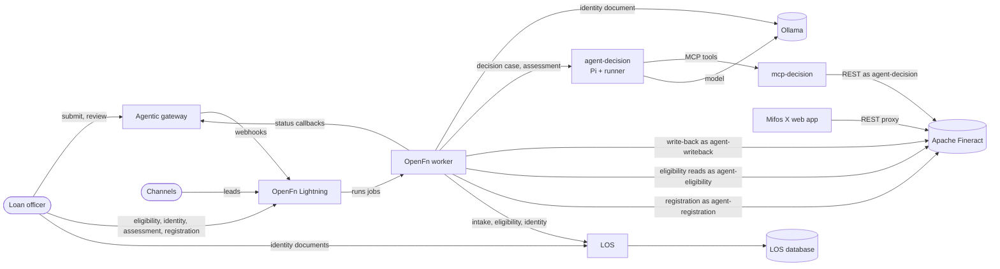
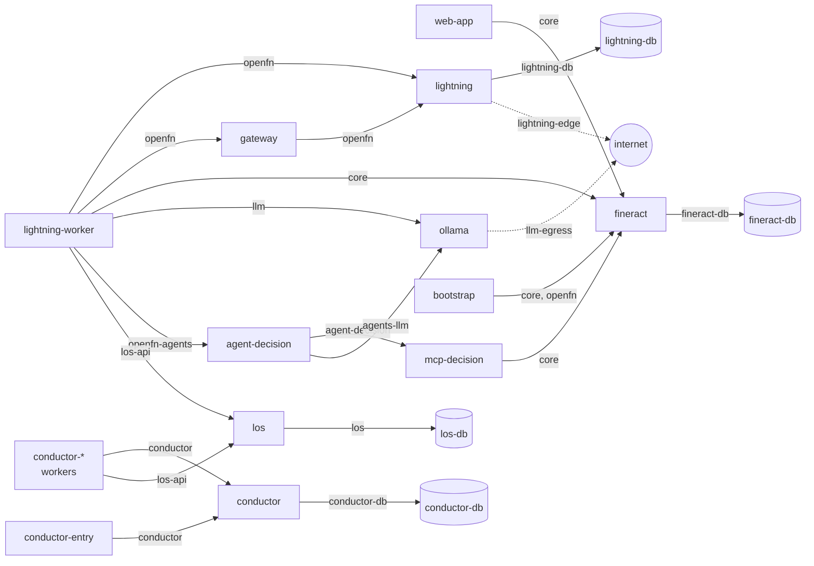
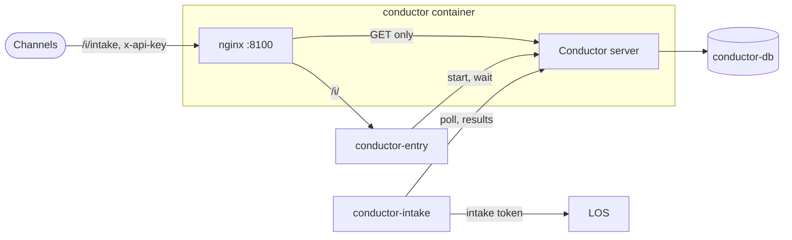

# Agentic Mifos sandbox

A self-contained environment for agentic loan origination on Mifos X, running entirely on your machine: Apache Fineract as the system of record, the Mifos X web app, OpenFn Lightning as the orchestrator, a loan API with human review, a loan origination service (LOS) for commercial opportunities, local models through Ollama, and Pi agents that reach Fineract only through their own scoped MCP server. Optionally, the commercial flow also runs on Conductor OSS, to compare the two engines (3.6).

It shows how agents can take part in lending while the rules, the guardrails and a human keep the decision. It is an **evaluation sandbox, not a production deployment**: section 7 says what protects what today, and what does not.

**Contents:** [1. What runs](#1-what-runs) · [2. Quick start](#2-quick-start) · [3. Architecture](#3-architecture) · [4. Using it](#4-using-it) · [5. Operating](#5-operating) · [6. Adding an agent](#6-adding-an-agent) · [7. Threat model](#7-threat-model) · [8. Related](#8-related)

## 1. What runs

| Group | Service | What it does | Port (127.0.0.1) | Profile |
|---|---|---|---|---|
| System of record | `fineract` | Apache Fineract (clients, loans, notes, roles) | — | default |
| | `fineract-db` | Its Postgres | — | default |
| | `web-app` | Mifos X web app, proxying the Fineract API | 4200 | default |
| Orchestration | `lightning` | OpenFn Lightning: the loan workflows, their run history | 4000 | default |
| | `lightning-db` | Its Postgres | — | default |
| | `lightning-setup` | One-shot: migrations, admin user, API token for the bootstrap | — | default |
| | `lightning-worker` | Runs the OpenFn jobs | — | default |
| | `bootstrap` | One-shot: loan product, agent users and roles in Fineract, Lightning credentials, the OpenFn project | — | default |
| | `lightning-webhook-auth` | One-shot: makes each webhook trigger require its own API key: the gateway's for loans, the channels' for intake | — | default |
| | `state-init` | One-shot: hands the bootstrap's state volume to an unprivileged user | — | default |
| Loan API | `gateway` | Agentic gateway: loan API, case state, human review | 8080 | default |
| Commercial | `los` | Loan origination service: opportunities before they reach Fineract ([los/README.md](los/README.md)) | 8090 | default |
| | `los-db` | Its Postgres | — | default |
| Models | `ollama` | Local models: a text model for the agents, a vision model for identity documents | — | `ollama` |
| | `ollama-init` | One-shot: hands the model volume to Ollama's unprivileged user | — | `ollama` |
| | `ollama-pull` | One-shot: downloads the two models | — | `ollama` |
| Agents | `agent-decision` | Pi agent behind an HTTP runner; serves the loan flow's decision step ([pi-agent/](pi-agent)) | — | `ollama`, `agents` |
| | `mcp-decision` | Its MCP server: the [Python MCP server](../python) with the `decision` tool profile, signed in as `agent-decision` | — | `ollama`, `agents` |
| Second engine | `conductor` | Conductor OSS: the commercial flow's workflows, for comparison with OpenFn ([agentic-banking-conductor](../agentic-banking-conductor/README.md)); its UI, read-only, and the entry at `/i/` | 8100 | `conductor` |
| | `conductor-db` | Its Postgres: state, queues and search | — | `conductor` |
| | `conductor-setup` | One-shot: loads the workflow and task definitions into Conductor | — | `conductor` |
| | `conductor-entry` | Starts workflows for channels and officers, with their API keys | — | `conductor` |
| | `conductor-intake` | The intake workflow's worker | — | `conductor` |

## 2. Quick start

**Prerequisites**

- Docker with Compose 2.20 or newer
- Disk: about 15 GB of images (9.4 GB of them the Ollama image, which bundles GPU libraries) and 5.2 GB for the two models
- Memory, measured in October 2026: the services use about 2.6 GB without a model loaded (Fineract alone 1.2 GB). Loading the text model adds about 2.7 GB, the vision model about 4 GB; Ollama keeps one model in memory at a time. On an 8 GB Docker VM shared with an IDE, model loads can stall (see [troubleshooting](#troubleshooting)). The `conductor` profile adds about 0.6 GB (measured in November 2026) and a 1.1 GB image

**Start**

```bash
cd agentic-mifos-sandbox
./scripts/gen-secrets.sh                              # creates .env with generated passwords and keys
docker compose up -d --build --wait                   # without local models: the rules decide
docker compose --profile ollama up -d --build --wait  # with Ollama and the decision agent
docker compose --profile conductor up -d --build --wait  # also the commercial flow on Conductor (3.6)
```

The first start takes about 3 minutes, most of it Fineract's database migrations. With the `ollama` profile the first start also downloads the two models (5.2 GB; about 20 minutes on a home connection). Later starts reuse everything.

| Open | Login |
|---|---|
| Web app: http://localhost:4200 | `mifos` / `FINERACT_ADMIN_PASSWORD` from `.env` |
| Lightning: http://localhost:4000 | `LIGHTNING_ADMIN_EMAIL` / `LIGHTNING_ADMIN_PASSWORD` from `.env` |
| Gateway: http://localhost:8080/actuator/health | none (see 7.4) |
| LOS API docs: http://localhost:8090/docs | **Authorize** with `LOS_OFFICER_TOKEN` from `.env` |
| Conductor (`conductor` profile): http://localhost:8100 | none: read-only (see 7.4) |

To see the commercial flow end to end, from a lead to a loan application in Fineract: `python3 scripts/demo.py` (4.9).

## 3. Architecture

### 3.1 Components



### 3.2 The loan flow

Each step with the status the gateway reports for the case:

1. **Submit**: `POST /api/loans/submit` (`OPENFN_TRIGGERED`). The gateway keeps the case and starts the OpenFn workflow through a webhook, sending its API key (`x-api-key`).
2. **Gather**: the application is normalised and the bank and credit data fetched; both are simulated in the sandbox (`GATHERING_DATA`).
3. **Documents**: a vision model reads and validates the CURP when a document is sent. The gateway reads the document paths from its own file system and the sandbox mounts none, so this step is skipped here. In the commercial flow, identity documents are uploaded to the LOS and checked there (3.3).
4. **Assess**: the specialist assessments (income, expense, credit) give the rules' recommendation.
5. **Decide**: `agent-decision` looks the applicant up in Fineract (existing client, loans, arrears) and recommends (`LLM_DECISION`). The OpenFn job then applies, in code: the **evidence gate** (the answer counts only if the agent looked the applicant up), the **guardrail** (never more lenient than the rules) and the **fallback** (the rules decide when the agent is unreachable, too slow or answers in another shape).
6. **Human review**: `PENDING_HUMAN_REVIEW`. The officer approves or rejects with `POST /api/loans/{id}/review`.
7. **Write-back**: the client, the loan and its approval are created in Fineract, with a decision note (recommendation, the agent's Fineract findings, the tools it called) and, when a document was read, a vision note (`WRITING_TO_FINERACT`, then `COMPLETED`). This job signs in as `agent-writeback`, whose role allows only these calls: it cannot disburse or administer users.
8. **Stall**: a case with no progress for 15 minutes turns `FAILED`; its error names the step and the Lightning run.

### 3.3 Commercial opportunities (LOS)

The LOS keeps commercial opportunities (leads and applicants) from first contact until they are registered in Fineract or discarded, in its own database. Stages run from `new` to `qualified`; `paused` and `discarded` need a reason code; only a `qualified` opportunity is registered, and its `external_id` becomes the loan's external ID in Fineract. Consent (bureau, SAT, contact) is recorded only through its own endpoint, with the LOS's timestamp. The LOS never calls Fineract: the registration workflow records the Fineract ids in it. Details: [los/README.md](los/README.md).

Leads arrive through the **intake** workflow (4.3). A channel (landing page, Mifos Mobile) posts the lead to its webhook with the channels' API key, and a job checks it with rules, no model, and records it in the LOS:

- The same `external_id` again is answered with the opportunity already recorded
- A lead with neither phone nor email is recorded as `discarded`, reason `no_contact`
- A lead with the CURP or phone of an open or paused opportunity is recorded as `paused`, reason `possible_duplicate`, with a note naming the match: a person decides
- Any other lead starts in `new`; the reply says whether it is complete and which fields are missing
- A lead the LOS cannot accept (an unreadable phone, an amount without a currency) is not recorded; the reply carries the LOS's error

Leads created directly through the LOS API, for example by an officer, skip intake.

Once the first contact has confirmed interest, amount and productive use, a person moves the opportunity to `qualifying`, and the **eligibility** workflow (4.4) checks it: an officer posts its id to the workflow's webhook with the officers' API key. Its jobs read the opportunity, look the applicant up in Fineract by CURP (the client's external ID, set by the write-back) as `agent-eligibility`, and apply rules, no model, in order:

- Not in `qualifying`: nothing changes (`not_qualifying`)
- A required field missing: it stays in `qualifying`, and the reply lists what to ask the applicant for (`request_data`)
- The currency, amount or term outside the Fineract loan product's limits, a loan in arrears, or an application already pending approval or disbursal: `paused`, with the first failure's reason code (`currency_not_offered`, `amount_out_of_range`, `term_out_of_range`, `in_arrears`, `open_application`) and a note naming every failure (`not_eligible`)
- A case the rules cannot judge (a closed or rejected client in Fineract, a product that does not repay monthly): `paused`, reason `needs_review`, for a person
- Otherwise: on to `documents` (`advance`)

The limits are read from the sandbox's loan product (USD 1,000 to 100,000, 1 to 60 monthly repayments), so an opportunity in MXN, like the examples in 4.2 and 4.3, is paused with `currency_not_offered`. Which rules apply per product, and their thresholds, are the institution's to set. Eligibility never discards an opportunity and never moves one past `documents`: pre-approval stays with risk and the officer.

In `documents`, an officer uploads the applicant's CURP constancia to the LOS (PNG or JPEG, at most 5 MB) and asks the **identity document** workflow (4.5) to check it, with the officers' API key. The webhook answers at once: the vision model takes longer on a CPU than Lightning waits for a reply, so the result is kept on the document in the LOS. The workflow reads the newest CURP document, has the vision model (`OLLAMA_VISION_MODEL`) read its clave, name, issue date and certification, and then applies rules, in order:

- No clave in the CURP format, or no name: `request_document` (`unreadable`); the opportunity stays in `documents` for another upload
- Another CURP or another name than the opportunity's: the document may be someone else's, so the opportunity is `paused`, reason `document_mismatch`, for a person (`curp_mismatch`, `name_mismatch`)
- Not certified ("CURP Certificada: verificada con el Registro Civil"), no issue date, or issued more than 30 days ago: `request_document` (`not_certified`, `issue_date_unreadable`, `expired`)
- Otherwise: `valid`, and on to `assessing`

Names match in any word order, without accents, and with a second surname missing. The model is a reading aid, not proof of identity: an image can mislead it, so an opportunity advances only when the CURP read from the image is the opportunity's own, and verifying it with RENAPO stays with risk and the officer. Unreadable or expired documents are asked for again rather than sent to a person; only a mismatch is. The LOS records the result and its move together, and refuses a check that no longer applies: a newer upload, or a CURP or name edited while the model read the image. The officer then asks again.

In `assessing`, an officer asks the **assessment** workflow (4.6) to assess it, with the officers' API key. The webhook answers at once (the decision agent can take minutes on a CPU); the assessment is kept in the LOS (`GET /opportunities/{id}/assessments`). Nothing is queried without the bureau consent the client gave and an officer recorded: the assessment then says `consent_missing`. Otherwise:

- **The bureau check is simulated** in the sandbox, like the loan flow's credit data: a real connector replaces that one job. Its result depends on the CURP's last character, so a demo can choose it: 0 to 5, score 720; 6 or 7, score 610; 8, score 520; 9, score 680 with 2 delinquent accounts
- **The rules**, with the loan flow's credit thresholds (placeholders for the institution's score inputs and weights): delinquent accounts or a score below 550, reject (`delinquent`, `bureau_score_low`); a score from 550 to 649 or an amount above 50,000, refer (`bureau_score_borderline`, `high_amount`); otherwise approve. A reject wins over a refer, and every reason is listed
- **The decision agent** looks a returning applicant up in Fineract and recommends, as in the loan flow: its answer counts only if it looked the applicant up, it may make the recommendation stricter but never more lenient (`decision_agent` then leads the reasons), and if it is unreachable, too slow or answers in another shape, the rules decide (`rules-fallback`, with the reason)

A reject pauses the opportunity with its reasons. Approve is a proposal: a person confirms it by moving the opportunity to `pre_approved`. Refer is theirs to decide. From there a person moves it on to `qualified`: the file stage is not automated yet. Once it is `qualified`, an officer asks the **registration** workflow (4.7) to register it in Fineract, with the officers' API key; the webhook answers when the run has finished. It checks first, and creates nothing otherwise: the opportunity is `qualified` (`not_qualified`), its newest CURP document was found `valid` and the CURP has not changed since (`identity_not_checked`), and its currency, amount and term still fit the loan product (`invalid`: the amount is never changed to fit). Then, as `agent-registration`:

- The client: external ID the CURP, active, its name split the Mexican way (the last two words are the surnames: "María José López García" is María José / López García). A returning applicant's client is reused, and activated if pending
- The identity document: the CURP image the identity check found `valid`, attached to the client (its Documents tab) before the loan application is made, and only once: its description names the LOS document
- The loan application: the requested amount and term, external ID the opportunity's, submitted and **never approved**: approval is Credit's, in Fineract (maker-checker)
- A note on the loan for Credit, from the LOS: the request, the eligibility and identity results, who qualified it, and the consents

The LOS then records the Fineract ids, and the opportunity is `registered`. Asked again after a run that stopped half way, it reuses the client, the loan and the note; a client that is closed, a loan with that external ID that no longer matches, or a mobile number that already belongs to another client (Fineract allows one client per number) goes to a person instead (`needs_review`). The LOS refuses the registration (409) if the CURP, name, amount, currency or term changed while the run made the application.

Every call to the LOS carries a caller's token: the intake job's lets it search, create and set aside new leads; the eligibility workflow's lets it read one opportunity and move it from `qualifying` to `documents` or `paused`; the identity workflow's lets it read an opportunity in `documents` and its documents, record a check, and move it to `assessing` or `paused`; the registration workflow's lets it read an opportunity, its documents (their images too) and its audit trail, and register it; the assessment workflow's lets it read an opportunity and record its assessment, whose only move is a reject to `paused`. None of them can record a consent or upload a document. The officers' token allows everything. The audit trail names the caller ([los/README.md](los/README.md), Access).

### 3.4 Agents

Each agent is a pair: `agent-<name>` (Pi, behind an HTTP runner) and `mcp-<name>` (the MCP server it may use). An OpenFn job calls the runner (`POST /run` with a bearer token and the case); the runner answers each case with a fresh Pi process and returns the final answer and the tools called.

What limits an agent, from the inside out:

1. **Pi** sees only its MCP server's tools: no shell, no files, no session files ([pi-agent/entrypoint.sh](pi-agent/entrypoint.sh)).
2. **The MCP tool profile** ([python/profiles.toml](../python/profiles.toml)) decides which tools exist at all; `decision` is read-only.
3. **The Fineract role** of the agent's service user ([fineract-rbac.json](fineract-rbac.json)): Fineract itself refuses anything outside it (HTTP 403).
4. **The network**: the agent reaches only its MCP server and Ollama; only the OpenFn worker reaches the agent.
5. **The OpenFn job**: evidence gate, guardrail and fallback, in code.
6. **A human** approves every loan.

### 3.5 Networks

Who talks to whom, with the network each connection uses; dotted lines are routes to the internet:



| Network | Internal | Members |
|---|---|---|
| `fineract-db` | yes | Fineract, its database |
| `core` | yes | Fineract and its API clients: web app, worker, bootstrap, MCP servers |
| `lightning-db` | yes | Lightning, its setup jobs, its database |
| `openfn` | yes | Lightning, worker, gateway, bootstrap |
| `llm` | yes | Ollama, its download job, the worker |
| `agents-llm` | yes | Ollama, the agents |
| `openfn-agents` | yes | The worker, the agents' runners |
| `agent-<name>` | yes | One agent and its MCP server |
| `los` | yes | The LOS and its database |
| `los-api` | yes | The LOS and the workers of the opportunity workflows (OpenFn's, and Conductor's that call the LOS), without the database |
| `conductor-db` | yes | Conductor and its database |
| `conductor` | yes | Conductor, its workers, the entry and the setup job: the server calls nothing else |
| `web-app-edge`, `gateway-edge`, `los-edge`, `conductor-edge` | no | One service each, for its published port |
| `lightning-edge` | no | Lightning and its setup job: published port, npm adaptor catalogue |
| `host-ollama` | no | Only with `docker-compose.host-ollama.yml`: the worker, to reach an Ollama server on the Docker host. Otherwise the worker has no route out: its OpenFn adaptors are built into its image from a lockfile ([worker/](worker/)) |
| `llm-egress` | no | Ollama, to download models |

Every service also runs with a read-only file system, no Linux capabilities, no privilege escalation, a non-root user and memory and process limits; [scripts/check-hardening.py](scripts/check-hardening.py) checks all of it, and the network memberships above, in CI.

### 3.6 The commercial flow on Conductor

With `--profile conductor`, the opportunity workflows also run on [Conductor OSS](https://conductor-oss.org), to compare the two engines on the same flow ([agentic-banking-conductor](../agentic-banking-conductor/README.md)). So far: intake. Both engines run against the same LOS and Fineract, as the same LOS callers and Fineract users, with the same rules, so a channel or an officer gets the same answers from either; only the way in and the run history differ.



- **One task per OpenFn job**, with the job's code: each task gets the state the one before returned, as in OpenFn. Retries are off, as in OpenFn; each task has its job's time limits, and a task no worker picks up within 60 seconds times the workflow out
- **One worker per workflow**, each with only its own credentials and networks (`conductor-intake`: the LOS's intake token, on `los-api`). OpenFn's single worker receives every workflow's credentials from Lightning
- **The entry** (`conductor-entry`) starts workflows: Conductor OSS has no authentication, so channels and officers call `/i/<workflow>` with the same API keys as Lightning's webhooks, and get the same replies (4.10)
- **The UI on 8100 is read-only**: the container's nginx ([conductor/nginx/default.conf](conductor/nginx/default.conf)) passes only GET requests to the API, and refuses the GETs that change something (polling for a task, the scheduler's and the server's admin) and any path with parameters (`;`). Conductor's own port is not published
- **The server** (3.34, Postgres only: no Redis or Elasticsearch) reaches only its database; JavaScript in a workflow cannot reach Java (`CONDUCTOR_APP_GRAALJS_RESTRICTEDHOSTACCESS`); one evaluation of a workflow runs at a time, locked in Postgres

Measured in November 2026 on the laptop of 4.9: the profile uses about 0.6 GB (the server 400 MiB, its database 100 MiB, the entry and a worker 30 to 50 MiB each), and the server starts in about 45 seconds. Idle, the server and its database take about 10% of a CPU core each, polling their queues; Lightning idles below 1%.

## 4. Using it

### 4.1 A loan

```bash
curl -s -X POST localhost:8080/api/loans/submit -H 'Content-Type: application/json' -d '{
  "applicantId": "APP-1001", "fullName": "Ana López", "email": "ana@example.com",
  "requestedAmount": 15000, "termMonths": 12, "documentPaths": []
}'
WF=<workflowId from the answer>
curl -s localhost:8080/api/loans/$WF/status     # until PENDING_HUMAN_REVIEW
curl -s localhost:8080/api/loans/$WF/summary    # recommendation; context.decision: source, history, toolCalls
curl -s -X POST localhost:8080/api/loans/$WF/review -H 'Content-Type: application/json' \
  -d '{"action": "APPROVE", "comments": "Checked by loan officer"}'
curl -s localhost:8080/api/loans/$WF/final      # after COMPLETED: the Fineract client and loan
```

`context.decision.source` is `agent-decision`, or `rules-fallback` with the reason in `error`. Each job's run and logs are in Lightning, under the project's History. In the web app, the new loan's Notes show the decision, with the agent's Fineract findings and the tools it called.

### 4.2 An opportunity in the LOS

```bash
AUTH="Authorization: Bearer $(grep '^LOS_OFFICER_TOKEN=' .env | cut -d= -f2-)"
curl -s -X POST localhost:8090/opportunities -H "$AUTH" -H 'Content-Type: application/json' -H 'X-Actor: officer-1' \
  -d '{"channel": "whatsapp", "full_name": "Ana López", "phone": "+52 55 1234-5678", "requested_amount": 15000, "currency": "MXN", "term_months": 12}'
ID=<id from the answer>
curl -s -X POST localhost:8090/opportunities/$ID/stage -H "$AUTH" -H 'Content-Type: application/json' -d '{"stage": "contacting"}'
curl -s -X POST localhost:8090/opportunities/$ID/consents/bureau -H "$AUTH"
curl -s localhost:8090/opportunities/$ID/events -H "$AUTH"          # the audit trail
```

The trail records the first change as `officer:officer-1` and the others as `officer`. Without the token the LOS answers 401. All endpoints, with request and answer shapes, are at http://localhost:8090/docs; use **Authorize** there with the same token.

### 4.3 A lead through intake

```bash
KEY=$(grep '^OPENFN_INTAKE_API_KEY=' .env | cut -d= -f2-)
curl -s -X POST localhost:4000/i/5ae8d72f-4cc5-4e83-98a6-27f8f40f1af1 -H "x-api-key: $KEY" \
  -H 'Content-Type: application/json' -d '{"channel": "web", "external_id": "web-1001",
  "full_name": "Ana López", "phone": "+52 55 8765-4321", "national_id": "LOPA800101MDFRRN09",
  "requested_amount": 15000, "currency": "MXN", "term_months": 12, "productive_use": "Stock for the shop"}'
```

The webhook answers when the run has finished, with the result in `data`:

```json
{"data": {"outcome": "complete", "stage": "new", "missing": [], "externalId": "web-1001", "opportunityId": "..."}, "meta": {"run_id": "..."}}
```

`outcome` is `complete`, `incomplete` (see `missing`), `possible_duplicate` (with `duplicateOf`), `discarded`, `already_received` or `invalid` (with the LOS's `errors`). Sending it again with another `external_id` gives `possible_duplicate`: the CURP and phone are now on an open opportunity. Without the key, or with the gateway's, the webhook answers 401 or 404.

### 4.4 Checking eligibility

```bash
AUTH="Authorization: Bearer $(grep '^LOS_OFFICER_TOKEN=' .env | cut -d= -f2-)"
KEY=$(grep '^OPENFN_OFFICER_API_KEY=' .env | cut -d= -f2-)
curl -s -X POST localhost:8090/opportunities -H "$AUTH" -H 'Content-Type: application/json' \
  -d '{"channel": "web", "full_name": "Rosa Díaz", "phone": "+52 55 2468-1357", "national_id": "DIAR850505MDFZSS02",
  "requested_amount": 5000, "currency": "USD", "term_months": 12, "productive_use": "A second sewing machine"}'
ID=<id from the answer>
curl -s -X POST localhost:8090/opportunities/$ID/stage -H "$AUTH" -H 'Content-Type: application/json' -d '{"stage": "qualifying"}'
curl -s -X POST localhost:4000/i/cdd00975-7e9f-42b6-b43b-bb4dc045a1e3 -H "x-api-key: $KEY" \
  -H 'Content-Type: application/json' -d "{\"opportunity_id\": \"$ID\"}"
```

The webhook answers when the three jobs have finished:

```json
{"data": {"decision": "advance", "stage": "documents", "reasons": [], "missing": [], "externalId": "opp-...", "opportunityId": "..."}, "meta": {"run_id": "..."}}
```

`decision` is `advance`, `request_data` (see `missing`), `not_eligible` or `needs_review` (both paused, see `reasons`), `not_qualifying` or `invalid` (an unknown `opportunity_id`). The lead from 4.3, moved to `qualifying` and checked the same way, is `not_eligible`: its currency, MXN, is not the product's. Without the key, or with the channels' or the gateway's, the webhook answers 401 or 404.

### 4.5 Checking an identity document

With the opportunity from 4.4 in `documents`, and `curp.png` an image of a CURP constancia with the opportunity's CURP and name (`scripts/demo_constancia.py` draws a fictitious one; see its header):

```bash
AUTH="Authorization: Bearer $(grep '^LOS_OFFICER_TOKEN=' .env | cut -d= -f2-)"
KEY=$(grep '^OPENFN_OFFICER_API_KEY=' .env | cut -d= -f2-)
ID=<id of the opportunity>
curl -s -X POST localhost:8090/opportunities/$ID/documents/curp -H "$AUTH" -H 'Content-Type: image/png' --data-binary @curp.png
curl -s -X POST localhost:4000/i/e48e6a55-52a4-43a8-baba-e4c092800ab9 -H "x-api-key: $KEY" \
  -H 'Content-Type: application/json' -d "{\"opportunity_id\": \"$ID\"}"
curl -s localhost:8090/opportunities/$ID/documents -H "$AUTH"      # once the run has finished
```

The webhook answers at once with the work order's id. Reading the image takes about 4 to 7 minutes on an 8-core CPU (seconds with a GPU), and then the document shows its result:

```json
{"documents": [{"kind": "curp", "content_type": "image/png", "check_result": "valid", "check_reasons": [],
  "extracted": {"curpClave": "...", "fullName": "...", "issueDate": "...", "civilRegistryVerified": true}, "...": "..."}]}
```

With `valid` the opportunity is in `assessing`. With `request_document`, `check_reasons` says why; upload another image and ask again. With `document_mismatch` the opportunity is `paused` for a person. The run's log in Lightning (History) has the decision and how long the model took.

### 4.6 Assessing an opportunity

With the opportunity from 4.5 in `assessing`: an officer records the client's bureau consent and asks for the assessment, then reads it:

```bash
AUTH="Authorization: Bearer $(grep '^LOS_OFFICER_TOKEN=' .env | cut -d= -f2-)"
KEY=$(grep '^OPENFN_OFFICER_API_KEY=' .env | cut -d= -f2-)
ID=<id of the opportunity>
curl -s -X POST localhost:8090/opportunities/$ID/consents/bureau -H "$AUTH"
curl -s -X POST localhost:4000/i/657417e5-882b-49e5-955e-2fc0ff9e5579 -H "x-api-key: $KEY" \
  -H 'Content-Type: application/json' -d "{\"opportunity_id\": \"$ID\"}"
curl -s localhost:8090/opportunities/$ID/assessments -H "$AUTH"      # once the run has finished
```

```json
{"assessments": [{"recommendation": "approve", "reasons": [], "bureau": {"provider": "simulated-bureau", "score": 720, "...": "..."},
  "rules": {"recommendation": "approve", "reasons": []}, "agent": {"recommendation": "approve", "source": "agent-decision", "findings": "...", "toolCalls": ["..."]}, "...": "..."}]}
```

With `approve`, the officer confirms by moving the opportunity to `pre_approved` (below); with `refer`, they decide; with `reject` it is `paused`, its reasons in `reason_code` and `reason_note`. The run's log in Lightning (History) has each step.

### 4.7 Registering a qualified opportunity

With the opportunity from 4.6 assessed: the officer confirms the pre-approval, moves it on to `qualified`, and asks for the registration:

```bash
# AUTH, KEY and ID as in 4.6
for stage in pre_approved qualified; do
  curl -s -X POST localhost:8090/opportunities/$ID/stage -H "$AUTH" -H 'Content-Type: application/json' -d "{\"stage\": \"$stage\"}"
done
curl -s -X POST localhost:4000/i/3170dc43-1d7e-48e7-ba83-1a4cd4af2844 -H "x-api-key: $KEY" \
  -H 'Content-Type: application/json' -d "{\"opportunity_id\": \"$ID\"}"
```

```json
{"data": {"decision": "registered", "stage": "registered", "clientId": 40, "loanId": 39, "reasons": [], "externalId": "opp-...", "opportunityId": "..."}, "meta": {"run_id": "..."}}
```

`decision` is `registered`, `not_qualified`, `identity_not_checked`, `invalid` or `needs_review` (see `reasons`). In the web app, the client (search by the CURP) has the CURP image under Documents, and a loan application "Submitted and pending approval" with the note for Credit, where a person approves or rejects it.

### 4.8 Asking an agent directly

```bash
docker compose --profile ollama run --rm agent-decision -p "List the loan products with their interest rates"
```

The agent has only its MCP server's tools. From a script, add `-T` and close stdin (`< /dev/null`): without a terminal, Pi reads stdin into the prompt and waits for it to end.

### 4.9 The demo: the commercial flow in one command

`scripts/demo.py` takes a fictitious applicant through the whole commercial flow, the way an officer drives it (4.3 to 4.7), and shows each decision as it is made. It needs Python 3.10 or newer on the host, and nothing else:

```bash
python3 scripts/demo.py               # the main run (the ollama profile up, or OLLAMA_URL set to your server)
python3 scripts/demo.py --scenarios   # then three cases the rules stop
python3 scripts/demo.py --fast        # the officer records the identity checks: no vision model
python3 scripts/demo.py --pause       # wait for Enter before each step, for presenting
```

The main run, in eight steps:

1. A lead arrives from the web channel (intake).
2. The officer moves it to `qualifying`, and eligibility checks it against the loan product and the applicant's history in Fineract.
3. The officer uploads the CURP constancia, and the vision model reads it. The script draws the constancia for the run in the MCP server's image (`scripts/demo_constancia.py`): fictitious, and marked as a test document.
4. The officer records the client's bureau consent.
5. The assessment: the simulated bureau, the rules and, if it is running, the decision agent.
6. The officer confirms the pre-approval and qualifies the opportunity.
7. Registration in Fineract.
8. What Credit sees in Fineract: the client with the CURP image under Documents, the loan application waiting for approval, and the note. The script ends with the web app link where a person approves or rejects it.

`--scenarios` adds three cases that end `paused` with their reason code: an amount above the product's limit (`amount_out_of_range`), a constancia with someone else's CURP (`document_mismatch`: the vision model reads it, or with `--fast` the officer records the mismatch), and a bureau score below 550 (`bureau_score_low`; the officer records its identity check, so that it reaches the assessment quickly).

Measured in November 2026 on a laptop CPU with 8 threads (Intel i5-10300H) and no GPU:

| Run | Took |
|---|---|
| `--fast`, with or without `--scenarios`, decision agent stopped | about 1 minute |
| The main run, decision agent stopped | 4 to 8 minutes: the vision model reads the constancia in 3 to 7 (longest when it first loads) |
| Any run with the decision agent running | 1 to 3 minutes more for each assessment, which waits for the agent |
| The main run with `--scenarios`, decision agent stopped | 7 to 12 minutes: the mismatch scenario uses the vision model too |

With the decision agent running, every assessment waits for its answer; `docker compose stop agent-decision` lets the rules decide at once. The script calls only the published ports, reads its keys and tokens from `.env` without printing them, and never starts or stops a service. Every run creates new applicants (CURPs starting with `PRUE`), so runs do not collide; they stay in the LOS and Fineract until a reset (5). It exits 0 when every step had its expected outcome, and otherwise names the step that did not. `python3 scripts/demo.py --check-config` only checks that the configuration has what the script needs.

### 4.10 Intake on Conductor

With the `conductor` profile up, the same lead as in 4.3, to Conductor's entry instead of Lightning's webhook, with the same key:

```bash
KEY=$(grep '^OPENFN_INTAKE_API_KEY=' .env | cut -d= -f2-)
curl -s -X POST localhost:8100/i/intake -H "x-api-key: $KEY" \
  -H 'Content-Type: application/json' -d '{"channel": "web", "external_id": "web-1002",
  "full_name": "Ana López", "phone": "+52 55 8765-4322", "national_id": "LOPA800101MDFRRN08",
  "requested_amount": 15000, "currency": "MXN", "term_months": 12, "productive_use": "Stock for the shop"}'
```

The answer is the one 4.3 describes, with the workflow's id in `meta`:

```json
{"data": {"outcome": "complete", "stage": "new", "missing": [], "externalId": "web-1002", "opportunityId": "..."}, "meta": {"state": "success", "workflow_id": "..."}}
```

Every outcome of 4.3 is the same on both engines, and the LOS records the same stage, reason code and note (checked in November 2026 with one lead of each outcome on each engine). Without the key, or with the officers', the entry answers 401. The run is at http://localhost:8100 (Executions), with each task's input, output and logs.

## 5. Operating

**Health and logs**: `docker compose ps` and `docker compose logs -f <service>`. The OpenFn jobs' own output (`console.log`) is in Lightning's run view, not in the worker's logs. The Conductor workers' lines are in both: each task's logs in Conductor's UI, and `docker compose logs conductor-<workflow>`.

**Settings** (`.env`; [.env.example](.env.example) explains each one)

| Setting | Default | What it changes |
|---|---|---|
| `WEBAPP_PORT`, `LIGHTNING_PORT`, `GATEWAY_PORT`, `LOS_PORT` | 4200, 4000, 8080, 8090 | Host ports (127.0.0.1 only) |
| `OLLAMA_MODEL` | `llama3.2:3b` | The agents' text model |
| `OLLAMA_VISION_MODEL` | `qwen2.5vl:3b` | The identity document model (the loan flow and the identity workflow) |
| `OLLAMA_MEM_LIMIT` | `6g` | Ollama's memory cap; keep it below Docker's total |
| `OLLAMA_URL` | the sandbox's Ollama | An Ollama server you already run, for the OpenFn jobs (the agents always use the sandbox's own). One on the Docker host (`http://host.docker.internal:11434`, e.g. Ollama on a Mac's GPU) also takes `-f docker-compose.yml -f docker-compose.host-ollama.yml` on every `docker compose` command, the worker's only route out |
| `LIGHTNING_WORKER_CAPACITY` | 2 | Runs the worker takes at a time |
| `LIGHTNING_WORKER_WATCHDOG_SECONDS` | 1200 | Seconds without worker output before the worker is restarted (7.4); keep it above a run's longest time (900) |
| `FINERACT_TIMEZONE` | `UTC` | The default tenant's time zone |
| `CONDUCTOR_PORT` | 8100 | Conductor's UI and entry (`conductor` profile) |
| `CONDUCTOR_WORKER_CONCURRENCY` | 2 | Tasks of each type a Conductor worker runs at a time |
| `FINERACT_IMAGE`, `WEBAPP_IMAGE`, `LIGHTNING_IMAGE`, `LIGHTNING_WORKER_IMAGE`, `OLLAMA_IMAGE`, `CONDUCTOR_IMAGE` | pinned | Test another version |

**Rotating secrets**

- Agent passwords (`FINERACT_AGENT_*_PASSWORD`), agent tokens (`AGENT_*_TOKEN`) and `OPENFN_CALLBACK_SECRET`: change the value in `.env` and run `docker compose --profile ollama up -d`. The bootstrap updates the agents' Fineract users and replaces the agents' Lightning credentials, including the write-back job's `fineract` and the eligibility and registration workflows' `fineract-eligibility` and `fineract-registration`. An edit made to one of them in Lightning lasts until its settings in `.env` change.
- `OPENFN_WEBHOOK_API_KEY`, `OPENFN_INTAKE_API_KEY` and `OPENFN_OFFICER_API_KEY`: the same. `lightning-webhook-auth` replaces the triggers' key, and the gateway restarts with the new one (and `conductor-entry`, with `--profile conductor` on that `up`); give channels the new intake key and officers the new officers' key.
- `LOS_INTAKE_TOKEN`, `LOS_ELIGIBILITY_TOKEN`, `LOS_IDENTITY_TOKEN`, `LOS_REGISTRATION_TOKEN`, `LOS_ASSESSMENT_TOKEN` and `LOS_OFFICER_TOKEN`: the same. The LOS restarts with the new tokens, and the bootstrap replaces the `los` and `los-<workflow>` credentials; a lead or a check sent in between gets a 401 from the LOS and can be sent again. The Conductor workers restart with theirs when `--profile conductor` is on that `up`. A changed `OLLAMA_URL` or `OLLAMA_VISION_MODEL` reaches the identity workflow's `ollama` credential the same way.
- **The database passwords and Lightning's admin password cannot be rotated through `.env`**: they are set when the volumes are first created. Changing them later breaks the connection (databases) or changes nothing (Lightning admin). Change them inside Postgres and Lightning first, or reset the volumes.
- `./scripts/gen-secrets.sh` fills only empty values: blank one and run it again to generate a new value.
- Fineract's admin password (`FINERACT_ADMIN_PASSWORD`): the bootstrap sets it only while the image's default (`password`) still works. To change it later, change it in the web app first (the user menu, then change password), then in `.env`.

**Updating**: `git pull`, `./scripts/gen-secrets.sh` (it adds any secret a new version needs), then `docker compose --profile ollama up -d --build --wait`, with `--profile conductor` added if you run Conductor: Compose does not remember profiles between commands, so without it the Conductor workers are not rebuilt and its definitions not reloaded. Volumes are kept. A sandbox from before the worker's adaptors were built into its image keeps an unused volume: `docker volume rm agentic-mifos-sandbox_lightning-worker-home`. Fineract keeps documents on a volume of its own, `fineract-documents`, which `up` creates; before it, Fineract could not save an uploaded document. With the `conductor` profile, a change to `conductor/nginx/` takes `docker compose --profile conductor restart conductor`: nginx reads it only when it starts, and `up` does not recreate a container whose mounted folder changed.

**Resetting**

```bash
docker compose --profile ollama --profile agents --profile conductor down -v   # deletes ALL data, the 5 GB of models included
# or keep the models:
docker compose --profile ollama --profile agents --profile conductor down
docker volume rm agentic-mifos-sandbox_fineract-db-data agentic-mifos-sandbox_fineract-documents \
  agentic-mifos-sandbox_lightning-db-data agentic-mifos-sandbox_los-db-data agentic-mifos-sandbox_bootstrap-state
docker volume rm agentic-mifos-sandbox_conductor-db-data   # if the conductor profile ever ran
```

### Troubleshooting

- **After a reboot (Docker Desktop on WSL), `fineract-db`, `lightning-db` or `web-app` exit with code 127**: Docker started them before WSL mounted the folder they read files from. Run `docker compose --profile ollama up -d` again.
- **After a `git pull`, a container fails to start with `error mounting ... no such file or directory`** (Docker Desktop): one of the files mounted on their own (`fineract-rbac.json`, the database init scripts, the web app's nginx template) was replaced, and the container still points at the old one. Recreate it, e.g. `docker compose up -d --force-recreate bootstrap`.
- **A case stays in `OPENFN_TRIGGERED`, and its run in Lightning stays `available`**: the worker stopped claiming runs (7.4). The watchdog restarts it within 20 minutes, and its log then shows `watchdog: no output from the worker ...`. To act at once, run `docker compose restart lightning-worker`, then submit the case again.
- **A case stays in `LLM_DECISION`, or Ollama's log shows a model load that never finishes**: there is not enough free memory for the model. Free memory (or stop services you do not need) and submit again; the case itself turns `FAILED` after 15 minutes and the rules decide when the agent does not answer in time.
- **A submit returns 500, and the gateway log shows `OpenFn webhook trigger failed: 401` or `404 ... Webhook not found`**: the gateway's API key is not the triggers' key. Run `docker compose --profile ollama up -d`, which applies `OPENFN_WEBHOOK_API_KEY` from `.env` to both.
- **A Conductor workflow ends `TIMED_OUT` with "Task poll timed out"**, and the entry answered 504: its worker was not running. Check `docker compose --profile conductor ps`, start it (`docker compose --profile conductor up -d conductor-<workflow>`) and send the request again.
- **The entry answers 502 `conductor_error`**: Conductor refused the request; callers get only the code, and `docker compose logs conductor-entry` shows Conductor's status. With `Conductor answered 404` there, the workflow is not defined in Conductor, for example after its database was reset while the entry kept running: run `docker compose --profile conductor up -d`, which runs `conductor-setup` again. (`conductor_unavailable` means Conductor did not answer: see `docker compose logs conductor`.)
- **An identity check records no result**: its run in Lightning failed, most often because the vision model did not answer within 9 minutes (not enough free memory, see the entry above, or a slower CPU), or because the LOS refused the check (409) after a newer upload or an edit of the CURP or name during the run. The document stays unchecked and the opportunity in `documents`; ask again once Ollama answers.
- **An opportunity workflow's runs fail, and their log in Lightning shows a 401 from the LOS**: the `los` or `los-<workflow>` credential does not hold the LOS's current `LOS_INTAKE_TOKEN` or `LOS_<WORKFLOW>_TOKEN`, for example after it was edited in Lightning. Delete that credential in Lightning and run `docker compose up -d`: the bootstrap creates it again from `.env`.
- **An assessment says `consent_missing`**: the client's bureau consent is not recorded. Record it (`POST /opportunities/{id}/consents/bureau`) and ask again. If the consent was recorded while an assessment run was going, the LOS refuses that run's `consent_missing` (409), and the run fails: ask again.
- **An assessment's agent says `rules-fallback`**: the decision agent was not used, and `agent.error` says why (unreachable, over 260 s, no Fineract lookup, another answer shape). The rules decided, as they would without an agent.
- **A registration answers `needs_review`**: Fineract already has something under the opportunity's ids that does not fit, as `reasons` says: a closed or rejected client with this CURP (`client_not_active`), or a loan application with the opportunity's external ID for another amount, term or client, or rejected (`loan_conflict`). Resolve it in the web app (reopen the client; reject the stale application, or correct the opportunity), then ask again. With `phone_in_use`, the opportunity's mobile number already belongs to the Fineract client the detail names, and Fineract allows one client per number; nothing was created. If the detail names no client ("another Fineract client"), find it by searching the web app for the number. If the number is someone else's (a relative's, a shared phone), correct the opportunity's phone (`PATCH /opportunities/{id}` with the applicant's own number) and ask again. If the applicant is that client under another record, a person first checks that client in the web app. Its status: an active client is reused and a pending one is activated, but a closed or rejected one must be reopened first, or the registration answers `client_not_active`. Its external ID: if it already has one, check what relies on it before changing it, and reconcile or escalate rather than overwrite it. Another CURP means another person's record, or a wrong CURP; `<workflow id>-client` links it to a case of the loan flow. If it is the same person and both are clear, set that client's external ID to the CURP: the registration then reuses it, as for any returning applicant.
- **An agent run never returns in a script**: stdin is open; add `-T` and `< /dev/null`.
- **`scripts/demo.py` stops with `the MCP server's image has no Pillow`**: the image was built before the MCP server needed Pillow. Rebuild it: `docker compose --profile ollama build mcp-decision`.
- **`docker compose up` fails on the first start**: read `docker compose logs lightning-setup bootstrap`; the bootstrap stops with the request that failed.
- **The bootstrap stops with `the password of Fineract's admin 'mifos' is neither FINERACT_ADMIN_PASSWORD nor the default`**: the password was changed in the web app, or this `.env` is new while Fineract's volume is not. Set `FINERACT_ADMIN_PASSWORD` to the current password.

## 6. Adding an agent

| File | Add |
|---|---|
| [python/profiles.toml](../python/profiles.toml) | Profile `<name>`: the tools the agent may use |
| [fineract-rbac.json](fineract-rbac.json) | Role `<name>`: its Fineract permissions; the bootstrap creates the user `agent-<name>` |
| [.env.example](.env.example) | `FINERACT_AGENT_<NAME>_PASSWORD=` and `AGENT_<NAME>_TOKEN=` (`gen-secrets.sh` fills them) |
| `pi-agent/skills/<name>.md` | Its instructions and answer shape ([decision.md](pi-agent/skills/decision.md) is an example) |
| [docker-compose.yml](docker-compose.yml) | `mcp-<name>` and `agent-<name>` (copy the decision pair), the internal network `agent-<name>`, and `AGENT_<NAME>_URL` / `AGENT_<NAME>_TOKEN` for the bootstrap |
| [agentic-banking-openfn/openfn/project.yaml](../agentic-banking-openfn/openfn/project.yaml) | The Lightning credential `agent-<name>` and a job that calls `<url>/run`, with its own evidence gate and fallback (copy the decision job). A deterministic job instead names `fineract-<name>` or `los-<name>`, which the bootstrap fills with the `agent-<name>` login or `LOS_<NAME>_TOKEN` |
| [los/auth.py](los/auth.py), if it calls the LOS | Caller `<name>`: what it may do there, and `LOS_<NAME>_TOKEN=` in `.env.example` and the `los` service |

A job on an adaptor, or an adaptor version, that no job used before also goes in [worker/package.json](worker/package.json) at that exact version, with its lockfile (`npm install --package-lock-only` in `worker/`): the worker has no route to npm, and CI checks that the two agree. Renovate bumps both, and `project.yaml`, in one PR.

CI then checks the new services: the hardening and network rules (the `agent-<name>` / `mcp-<name>` pattern needs no change to the check), that every adaptor in `project.yaml` is pinned to an exact version and built into the worker image, the runner tests, the agent and worker image builds, and the Python CI for the profile.

## 7. Threat model

This is a local evaluation sandbox. The model below says what protects what today; section 7.4 lists what does not.

### 7.1 Assets

- Client personal data: names, CURP, phone, email, loan and savings data, in Fineract, the LOS, Lightning's run data, Conductor's workflow data (with `--profile conductor`) and the decision notes; identity document images, in the LOS, Fineract (the client's documents) and Lightning's run data; bureau results, in the LOS's assessments
- Fineract's integrity: clients, loans and approvals
- Secrets: `.env` (database passwords, Lightning keys, agent passwords and tokens, the LOS tokens, the callback secret)
- The host machine

### 7.2 Trust boundaries

- **Untrusted**: application and LOS input, identity documents, model output, and tool results (Fineract data can carry injected text)
- **Constrained**: the agents. The model assumes a prompt injection fully controls an agent, and asks what it can still do
- **Trusted**: Fineract, the gateway, Lightning, the worker and the job code it runs, Conductor and its workers, entry and setup, and the operator who holds `.env`
- **Anyone on the host**: the published ports are bound to 127.0.0.1, but any local user or process can reach them

### 7.3 Threats and mitigations

| Threat | What stops it | What remains |
|---|---|---|
| A prompt injection makes an agent misuse its tools | Only its profile's tools (the decision profile is read-only); its Fineract role (403); no shell or files in Pi | The agent can read what its profile allows |
| An agent invents findings or a recommendation | The evidence gate and check; the guardrail; the tools called, listed in the note or the assessment; human approval or confirmation | A stricter but wrong answer from an agent that did look the applicant up |
| An agent takes credentials | Agents hold no Fineract password, only their runner token; no tool can read their environment | — |
| A compromised job or adaptor uses the write-back login | The `agent-writeback` role: no disbursement, no user administration; paying a loan out takes a person in the web app | It can create clients and loans and approve them |
| A compromised job uses the LOS | The intake token: search, create, and set aside a lead still in `new`. The eligibility token: read one opportunity, and move it from `qualifying` to `documents` or `paused`. The identity token: read an opportunity and its documents, record a check, and move it from `documents` to `assessing` or `paused`. The registration token: read an opportunity, its documents and their images, and its audit trail, and register a `qualified` one. The assessment token: read an opportunity and record its assessment, whose only move is a reject to `paused`. None records consents, edits or uploads, or moves an opportunity between stages other than its own (403) | Intake can read every opportunity: it searches them for duplicates. Eligibility can move any `qualifying` opportunity on to `documents`, identity any opportunity in `documents` on to `assessing`; identity and registration can read any opportunity's documents |
| A forged or misleading identity document | The CURP read from the image must be the opportunity's, and the name must match; a mismatch goes to a person. The model's answer is data, checked by rules | A forgery with the right CURP and name; text in an image that misleads the model. The model is a reading aid: RENAPO verification stays with risk and the officer |
| A compromised job uses the eligibility login | The `agent-eligibility` role: reading clients and loan products only (403 on anything else) | It can read any client's record and accounts |
| A compromised job uses the registration login | The `agent-registration` role: no approval, disbursement or user administration; the bootstrap checks each refusal on every start | It can create and activate clients, attach documents to them, submit loan applications and add notes |
| A compromised container moves sideways | Segmented networks: each database only from its application, agents only to their MCP server and Ollama | The worker is on `core` (the write-back job) |
| Data leaves the machine | Fineract, the MCP servers, the agents and the Conductor workers have no route out | The web app, gateway, LOS and Conductor (published ports), and Lightning and Ollama (downloads), do; the worker only with the host-Ollama override |
| Container escape or privilege escalation | Read-only file systems, no capabilities, no privilege escalation, non-root users, process limits; root only in two one-shot jobs without a network | — |
| Spoofed callbacks or agent calls | `X-OpenFn-Secret` on the gateway callbacks; a bearer token per agent runner; an API key on the Lightning webhook triggers, one for the loan triggers, one for intake and one for officers' eligibility, identity, assessment and registration requests (`[REDACTED]` in run data); a token per LOS caller | — |
| Someone on the host uses Conductor's API to start, change or claim work (`--profile conductor`) | Its port is not published; on `CONDUCTOR_PORT`, nginx passes only GET requests to the API and refuses polling for tasks, admin and path parameters (`;`); workflows start only through `conductor-entry`, with the channels' or officers' key | Reading: anyone on the host can read every workflow's input and output in the UI (7.4) |
| Workflow JavaScript reaches the server's Java (GHSA-77c4-x563-ccgr) | Conductor 3.34 with `CONDUCTOR_APP_GRAALJS_RESTRICTEDHOSTACCESS`; the sandbox's workflows use no JavaScript; definitions cannot be changed from the published port | — |
| A compromised Conductor worker | Each workflow's worker holds only its own LOS token (and later its own Fineract login) and joins only the networks of the services it calls, checked in CI | What that workflow's LOS caller may do (3.3) |
| Exhausted memory or processes | Memory and process limits; one case at a time per agent with a timeout; the 15-minute stall check | — |
| Supply chain | Images pinned by tag or digest, Pi from a lockfile, OpenFn adaptors pinned to exact versions and built into the worker image from a lockfile (both checked in CI), Renovate updates, images built in CI | — |

### 7.4 Known limits

- **Secrets are environment variables**: anyone who can run `docker inspect` can read them
- **The OpenFn worker is on `core`**, because the write-back job calls Fineract directly (as `agent-writeback`)
- **Services with a published port have outbound internet**: Docker publishes ports only from networks with a route out
- **The gateway API has no authentication**: it is reachable from the host only (127.0.0.1)
- **People share one LOS token** (`LOS_OFFICER_TOKEN`), so the LOS records the name in `X-Actor` as sent. The trail still shows the change came with the officer token (`officer:<name>`)
- **The webhook API key is set through Lightning's internal functions** (`lightning-webhook-auth`), as Lightning has no API for it: a Lightning upgrade that changes them makes the job, and so `up`, fail. On a new sandbox the triggers are open for the few seconds before the job's first run
- **The bureau check is simulated**: the assessment's bureau result comes from the CURP's last character, not from a bureau. A real connector, with its consent evidence, replaces one job
- **No TLS between services**, and Fineract's self-signed certificate is not verified
- **Application data and the callback secret are stored in Lightning's run data** (the webhook bodies), and so are identity document images, which pass through it from the LOS to the vision model and to Fineract. Lightning can erase run data per project, which would also affect every workflow's history
- **The OpenFn worker can stop claiming runs after a reconnect** (a ws-worker bug, still in 1.30.0): a watchdog restarts it after 20 minutes without output. Cases submitted meanwhile turn `FAILED` and must be submitted again
- **Agents can reach each other's runners** on `agents-llm` / `openfn-agents`; each runner requires its own token
- **Conductor's UI needs no login** (`--profile conductor`): Conductor OSS has no authentication. The UI is read-only, but anyone on the host can read every workflow's input and output there, which hold applicants' names, CURPs and phone numbers. Lightning's UI requires a login

### 7.5 Measured agent reliability

The decision agent, measured in October 2026 on a CPU-only laptop against seeded applicants (a new applicant, a client with a clean loan, a client in arrears), six cases per round:

| Model | Answer in the required shape | Fineract history correct |
|---|---|---|
| `llama3.2:3b`, first skill, 150 s | 0/6 (3 timeouts) | 0/6 |
| `llama3.2:3b`, current skill, 240 s | 1/6 | 1/6 |
| `qwen2.5:3b`, current skill | 4/6 | 0/6 (no lookup in 5 runs) |

With 3B models on CPU the agent rarely gives a usable, correct answer, so in practice the rules decide; the evidence gate makes sure an answer without a lookup never counts. A stronger model is the next step. The vision model's accuracy was not measured here.

## 8. Related

- [los/README.md](los/README.md): the LOS's stages, rules and API
- [python/README.md](../python/README.md): the MCP server, its tool profiles and its HTTP transport
- [agentic-banking-openfn/README.md](../agentic-banking-openfn/README.md): the gateway and the OpenFn project, set up by hand without this sandbox
- [agentic-banking-conductor/README.md](../agentic-banking-conductor/README.md): the commercial flow on Conductor OSS: definitions, workers, entry
