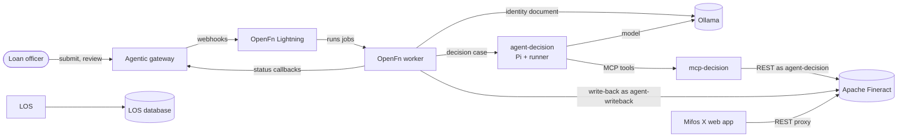
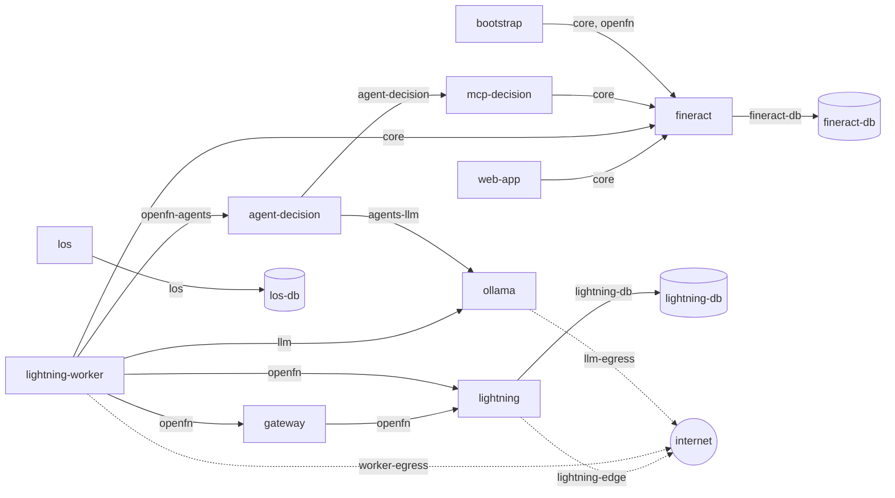

# Agentic Mifos sandbox

A self-contained environment for agentic loan origination on Mifos X, running entirely on your machine: Apache Fineract as the system of record, the Mifos X web app, OpenFn Lightning as the orchestrator, a loan API with human review, a loan origination service (LOS) for commercial opportunities, local models through Ollama, and Pi agents that reach Fineract only through their own scoped MCP server.

It shows how agents can take part in lending while the rules, the guardrails and a human keep the decision. It is an **evaluation sandbox, not a production deployment**: section 7 says what protects what today, and what does not.

**Contents:** [1. What runs](#1-what-runs) · [2. Quick start](#2-quick-start) · [3. Architecture](#3-architecture) · [4. Using it](#4-using-it) · [5. Operating](#5-operating) · [6. Adding an agent](#6-adding-an-agent) · [7. Threat model](#7-threat-model) · [8. Related](#8-related)

## 1. What runs

| Group | Service | What it does | Port (127.0.0.1) | Profile |
|---|---|---|---|---|
| System of record | `fineract` | Apache Fineract (clients, loans, notes, roles) | — | default |
| | `fineract-db` | Its Postgres | — | default |
| | `web-app` | Mifos X web app, proxying the Fineract API | 4200 | default |
| Orchestration | `lightning` | OpenFn Lightning: the loan workflows, their run history | 4000 | default |
| | `lightning-db` | Its Postgres | — | default |
| | `lightning-setup` | One-shot: migrations, admin user, API token for the bootstrap | — | default |
| | `lightning-worker` | Runs the OpenFn jobs | — | default |
| | `bootstrap` | One-shot: loan product, agent users and roles in Fineract, Lightning credentials, the OpenFn project | — | default |
| | `lightning-webhook-auth` | One-shot: makes both webhook triggers require the gateway's API key | — | default |
| | `state-init` | One-shot: hands the bootstrap's state volume to an unprivileged user | — | default |
| Loan API | `gateway` | Agentic gateway: loan API, case state, human review | 8080 | default |
| Commercial | `los` | Loan origination service: opportunities before they reach Fineract ([los/README.md](los/README.md)) | 8090 | default |
| | `los-db` | Its Postgres | — | default |
| Models | `ollama` | Local models: a text model for the agents, a vision model for identity documents | — | `ollama` |
| | `ollama-init` | One-shot: hands the model volume to Ollama's unprivileged user | — | `ollama` |
| | `ollama-pull` | One-shot: downloads the two models | — | `ollama` |
| Agents | `agent-decision` | Pi agent behind an HTTP runner; serves the loan flow's decision step ([pi-agent/](pi-agent)) | — | `ollama`, `agents` |
| | `mcp-decision` | Its MCP server: the [Python MCP server](../python) with the `decision` tool profile, signed in as `agent-decision` | — | `ollama`, `agents` |

## 2. Quick start

**Prerequisites**

- Docker with Compose 2.20 or newer
- Disk: about 15 GB of images (9.4 GB of them the Ollama image, which bundles GPU libraries) and 5.2 GB for the two models
- Memory, measured in October 2026: the services use about 2.6 GB without a model loaded (Fineract alone 1.2 GB). Loading the text model adds about 2.7 GB, the vision model about 4 GB; Ollama keeps one model in memory at a time. On an 8 GB Docker VM shared with an IDE, model loads can stall (see [troubleshooting](#troubleshooting))

**Start**

```bash
cd agentic-mifos-sandbox
./scripts/gen-secrets.sh                              # creates .env with generated passwords and keys
docker compose up -d --build --wait                   # without local models: the rules decide
docker compose --profile ollama up -d --build --wait  # with Ollama and the decision agent
```

The first start takes about 3 minutes, most of it Fineract's database migrations. With the `ollama` profile the first start also downloads the two models (5.2 GB; about 20 minutes on a home connection). Later starts reuse everything.

| Open | Login |
|---|---|
| Web app: http://localhost:4200 | `mifos` / `FINERACT_ADMIN_PASSWORD` from `.env` |
| Lightning: http://localhost:4000 | `LIGHTNING_ADMIN_EMAIL` / `LIGHTNING_ADMIN_PASSWORD` from `.env` |
| Gateway: http://localhost:8080/actuator/health | none (see 7.4) |
| LOS API docs: http://localhost:8090/docs | none (see 7.4) |

## 3. Architecture

### 3.1 Components



### 3.2 The loan flow

Each step with the status the gateway reports for the case:

1. **Submit**: `POST /api/loans/submit` (`OPENFN_TRIGGERED`). The gateway keeps the case and starts the OpenFn workflow through a webhook, sending its API key (`x-api-key`).
2. **Gather**: the application is normalised and the bank and credit data fetched; both are simulated in the sandbox (`GATHERING_DATA`).
3. **Documents**: a vision model reads and validates the CURP when a document is sent. The gateway reads the document paths from its own file system and the sandbox mounts none, so this step is skipped here; the identity document agent is planned.
4. **Assess**: the specialist assessments (income, expense, credit) give the rules' recommendation.
5. **Decide**: `agent-decision` looks the applicant up in Fineract (existing client, loans, arrears) and recommends (`LLM_DECISION`). The OpenFn job then applies, in code: the **evidence gate** (the answer counts only if the agent looked the applicant up), the **guardrail** (never more lenient than the rules) and the **fallback** (the rules decide when the agent is unreachable, too slow or answers in another shape).
6. **Human review**: `PENDING_HUMAN_REVIEW`. The officer approves or rejects with `POST /api/loans/{id}/review`.
7. **Write-back**: the client, the loan and its approval are created in Fineract, with a decision note (recommendation, the agent's Fineract findings, the tools it called) and, when a document was read, a vision note (`WRITING_TO_FINERACT`, then `COMPLETED`). This job signs in as `agent-writeback`, whose role allows only these calls: it cannot disburse or administer users.
8. **Stall**: a case with no progress for 15 minutes turns `FAILED`; its error names the step and the Lightning run.

### 3.3 Commercial opportunities (LOS)

The LOS keeps commercial opportunities (leads and applicants) from first contact until they are registered in Fineract or discarded, in its own database. Stages run from `new` to `qualified`; `paused` and `discarded` need a reason code; only a `qualified` opportunity is registered, and its `external_id` becomes the loan's external ID in Fineract. Consent (bureau, SAT, contact) is recorded only through its own endpoint, with the LOS's timestamp. The LOS never calls Fineract: the write-back records the Fineract ids in it. Details: [los/README.md](los/README.md). The intake and eligibility agents that will work on it are planned.

### 3.4 Agents

Each agent is a pair: `agent-<name>` (Pi, behind an HTTP runner) and `mcp-<name>` (the MCP server it may use). An OpenFn job calls the runner (`POST /run` with a bearer token and the case); the runner answers each case with a fresh Pi process and returns the final answer and the tools called.

What limits an agent, from the inside out:

1. **Pi** sees only its MCP server's tools: no shell, no files, no session files ([pi-agent/entrypoint.sh](pi-agent/entrypoint.sh)).
2. **The MCP tool profile** ([python/profiles.toml](../python/profiles.toml)) decides which tools exist at all; `decision` is read-only.
3. **The Fineract role** of the agent's service user ([fineract-rbac.json](fineract-rbac.json)): Fineract itself refuses anything outside it (HTTP 403).
4. **The network**: the agent reaches only its MCP server and Ollama; only the OpenFn worker reaches the agent.
5. **The OpenFn job**: evidence gate, guardrail and fallback, in code.
6. **A human** approves every loan.

### 3.5 Networks

Who talks to whom, with the network each connection uses; dotted lines are routes to the internet:



| Network | Internal | Members |
|---|---|---|
| `fineract-db` | yes | Fineract, its database |
| `core` | yes | Fineract and its API clients: web app, worker, bootstrap, MCP servers |
| `lightning-db` | yes | Lightning, its setup jobs, its database |
| `openfn` | yes | Lightning, worker, gateway, bootstrap |
| `llm` | yes | Ollama, its download job, the worker |
| `agents-llm` | yes | Ollama, the agents |
| `openfn-agents` | yes | The worker, the agents' runners |
| `agent-<name>` | yes | One agent and its MCP server |
| `los` | yes | The LOS and its database |
| `web-app-edge`, `gateway-edge`, `los-edge` | no | One service each, for its published port |
| `lightning-edge` | no | Lightning and its setup job: published port, npm adaptor catalogue |
| `worker-egress` | no | The worker, to install adaptors from npm |
| `llm-egress` | no | Ollama, to download models |

Every service also runs with a read-only file system, no Linux capabilities, no privilege escalation, a non-root user and memory and process limits; [scripts/check-hardening.py](scripts/check-hardening.py) checks all of it, and the network memberships above, in CI.

## 4. Using it

### 4.1 A loan

```bash
curl -s -X POST localhost:8080/api/loans/submit -H 'Content-Type: application/json' -d '{
  "applicantId": "APP-1001", "fullName": "Ana López", "email": "ana@example.com",
  "requestedAmount": 15000, "termMonths": 12, "documentPaths": []
}'
WF=<workflowId from the answer>
curl -s localhost:8080/api/loans/$WF/status     # until PENDING_HUMAN_REVIEW
curl -s localhost:8080/api/loans/$WF/summary    # recommendation; context.decision: source, history, toolCalls
curl -s -X POST localhost:8080/api/loans/$WF/review -H 'Content-Type: application/json' \
  -d '{"action": "APPROVE", "comments": "Checked by loan officer"}'
curl -s localhost:8080/api/loans/$WF/final      # after COMPLETED: the Fineract client and loan
```

`context.decision.source` is `agent-decision`, or `rules-fallback` with the reason in `error`. Each job's run and logs are in Lightning, under the project's History. In the web app, the new loan's Notes show the decision, with the agent's Fineract findings and the tools it called.

### 4.2 An opportunity in the LOS

```bash
curl -s -X POST localhost:8090/opportunities -H 'Content-Type: application/json' -H 'X-Actor: officer-1' \
  -d '{"channel": "whatsapp", "full_name": "Ana López", "phone": "+52 55 1234-5678", "requested_amount": 15000, "currency": "MXN", "term_months": 12}'
ID=<id from the answer>
curl -s -X POST localhost:8090/opportunities/$ID/stage -H 'Content-Type: application/json' -d '{"stage": "contacting"}'
curl -s -X POST localhost:8090/opportunities/$ID/consents/bureau
curl -s localhost:8090/opportunities/$ID/events          # the audit trail
```

All endpoints, with request and answer shapes, are at http://localhost:8090/docs.

### 4.3 Asking an agent directly

```bash
docker compose --profile ollama run --rm agent-decision -p "List the loan products with their interest rates"
```

The agent has only its MCP server's tools. From a script, add `-T` and close stdin (`< /dev/null`): without a terminal, Pi reads stdin into the prompt and waits for it to end.

## 5. Operating

**Health and logs**: `docker compose ps` and `docker compose logs -f <service>`. The OpenFn jobs' own output (`console.log`) is in Lightning's run view, not in the worker's logs.

**Settings** (`.env`; [.env.example](.env.example) explains each one)

| Setting | Default | What it changes |
|---|---|---|
| `WEBAPP_PORT`, `LIGHTNING_PORT`, `GATEWAY_PORT`, `LOS_PORT` | 4200, 4000, 8080, 8090 | Host ports (127.0.0.1 only) |
| `OLLAMA_MODEL` | `llama3.2:3b` | The agents' text model |
| `OLLAMA_VISION_MODEL` | `qwen2.5vl:3b` | The identity document model |
| `OLLAMA_MEM_LIMIT` | `6g` | Ollama's memory cap; keep it below Docker's total |
| `OLLAMA_URL` | the sandbox's Ollama | An Ollama server you already run, for the OpenFn jobs (the agents always use the sandbox's own) |
| `LIGHTNING_WORKER_CAPACITY` | 2 | Runs the worker takes at a time |
| `FINERACT_TIMEZONE` | `UTC` | The default tenant's time zone |
| `FINERACT_IMAGE`, `WEBAPP_IMAGE`, `LIGHTNING_IMAGE`, `LIGHTNING_WORKER_IMAGE`, `OLLAMA_IMAGE` | pinned | Test another version |

**Rotating secrets**

- Agent passwords (`FINERACT_AGENT_*_PASSWORD`), agent tokens (`AGENT_*_TOKEN`) and `OPENFN_CALLBACK_SECRET`: change the value in `.env` and run `docker compose --profile ollama up -d`. The bootstrap updates the agents' Fineract users and replaces the agents' Lightning credentials, including the write-back job's `fineract`. An edit made to one of them in Lightning lasts until its settings in `.env` change.
- `OPENFN_WEBHOOK_API_KEY`: the same. `lightning-webhook-auth` replaces the triggers' key, and the gateway restarts with the new one.
- **The database passwords and Lightning's admin password cannot be rotated through `.env`**: they are set when the volumes are first created. Changing them later breaks the connection (databases) or changes nothing (Lightning admin). Change them inside Postgres and Lightning first, or reset the volumes.
- `./scripts/gen-secrets.sh` fills only empty values: blank one and run it again to generate a new value.
- Fineract's admin password (`FINERACT_ADMIN_PASSWORD`): the bootstrap sets it only while the image's default (`password`) still works. To change it later, change it in the web app first (the user menu, then change password), then in `.env`.

**Updating**: `git pull`, `./scripts/gen-secrets.sh` (it adds any secret a new version needs), then `docker compose --profile ollama up -d --build --wait`. Volumes are kept.

**Resetting**

```bash
docker compose --profile ollama --profile agents down -v   # deletes ALL data, the 5 GB of models included
# or keep the models:
docker compose --profile ollama --profile agents down
docker volume rm agentic-mifos-sandbox_fineract-db-data agentic-mifos-sandbox_lightning-db-data \
  agentic-mifos-sandbox_los-db-data agentic-mifos-sandbox_bootstrap-state agentic-mifos-sandbox_lightning-worker-home
```

### Troubleshooting

- **After a reboot (Docker Desktop on WSL), `fineract-db`, `lightning-db` or `web-app` exit with code 127**: Docker started them before WSL mounted the folder they read files from. Run `docker compose --profile ollama up -d` again.
- **After a `git pull`, a container fails to start with `error mounting ... no such file or directory`** (Docker Desktop): one of the files mounted on their own (`fineract-rbac.json`, the database init scripts, the web app's nginx template) was replaced, and the container still points at the old one. Recreate it, e.g. `docker compose up -d --force-recreate bootstrap`.
- **A case stays in `LLM_DECISION`, or Ollama's log shows a model load that never finishes**: there is not enough free memory for the model. Free memory (or stop services you do not need) and submit again; the case itself turns `FAILED` after 15 minutes and the rules decide when the agent does not answer in time.
- **A submit returns 500, and the gateway log shows `OpenFn webhook trigger failed: 401` or `404 ... Webhook not found`**: the gateway's API key is not the triggers' key. Run `docker compose --profile ollama up -d`, which applies `OPENFN_WEBHOOK_API_KEY` from `.env` to both.
- **An agent run never returns in a script**: stdin is open; add `-T` and `< /dev/null`.
- **`docker compose up` fails on the first start**: read `docker compose logs lightning-setup bootstrap`; the bootstrap stops with the request that failed.
- **The bootstrap stops with `the password of Fineract's admin 'mifos' is neither FINERACT_ADMIN_PASSWORD nor the default`**: the password was changed in the web app, or this `.env` is new while Fineract's volume is not. Set `FINERACT_ADMIN_PASSWORD` to the current password.

## 6. Adding an agent

| File | Add |
|---|---|
| [python/profiles.toml](../python/profiles.toml) | Profile `<name>`: the tools the agent may use |
| [fineract-rbac.json](fineract-rbac.json) | Role `<name>`: its Fineract permissions; the bootstrap creates the user `agent-<name>` |
| [.env.example](.env.example) | `FINERACT_AGENT_<NAME>_PASSWORD=` and `AGENT_<NAME>_TOKEN=` (`gen-secrets.sh` fills them) |
| `pi-agent/skills/<name>.md` | Its instructions and answer shape ([decision.md](pi-agent/skills/decision.md) is an example) |
| [docker-compose.yml](docker-compose.yml) | `mcp-<name>` and `agent-<name>` (copy the decision pair), the internal network `agent-<name>`, and `AGENT_<NAME>_URL` / `AGENT_<NAME>_TOKEN` for the bootstrap |
| [agentic-banking-openfn/openfn/project.yaml](../agentic-banking-openfn/openfn/project.yaml) | The Lightning credential `agent-<name>` and a job that calls `<url>/run`, with its own evidence gate and fallback (copy the decision job) |

CI then checks the new services: the hardening and network rules (the `agent-<name>` / `mcp-<name>` pattern needs no change to the check), that every adaptor in `project.yaml` is pinned to an exact version, the runner tests, the agent image build, and the Python CI for the profile.

## 7. Threat model

This is a local evaluation sandbox. The model below says what protects what today; section 7.4 lists what does not.

### 7.1 Assets

- Client personal data: names, CURP, phone, email, loan and savings data, in Fineract, the LOS, Lightning's run data and the decision notes
- Fineract's integrity: clients, loans and approvals
- Secrets: `.env` (database passwords, Lightning keys, agent passwords and tokens, the callback secret)
- The host machine

### 7.2 Trust boundaries

- **Untrusted**: application and LOS input, identity documents, model output, and tool results (Fineract data can carry injected text)
- **Constrained**: the agents. The model assumes a prompt injection fully controls an agent, and asks what it can still do
- **Trusted**: Fineract, the gateway, Lightning, the worker and the job code it runs, and the operator who holds `.env`
- **Anyone on the host**: the published ports are bound to 127.0.0.1, but any local user or process can reach them

### 7.3 Threats and mitigations

| Threat | What stops it | What remains |
|---|---|---|
| A prompt injection makes an agent misuse its tools | Only its profile's tools (the decision profile is read-only); its Fineract role (403); no shell or files in Pi | The agent can read what its profile allows |
| An agent invents findings or a recommendation | The evidence gate and check; the guardrail; the tools called, listed in the note; human approval | A stricter but wrong answer from an agent that did look the applicant up |
| An agent takes credentials | Agents hold no Fineract password, only their runner token; no tool can read their environment | — |
| A compromised job or adaptor uses the write-back login | The `agent-writeback` role: no disbursement, no user administration; paying a loan out takes a person in the web app | It can create clients and loans and approve them; an adaptor's own dependencies are resolved when it is installed (7.4) |
| A compromised container moves sideways | Segmented networks: each database only from its application, agents only to their MCP server and Ollama | The worker is on `core` (the write-back job) |
| Data leaves the machine | Fineract, the MCP servers and the agents have no route out | The web app, gateway and LOS (published ports), and Lightning, the worker and Ollama (downloads), do |
| Container escape or privilege escalation | Read-only file systems, no capabilities, no privilege escalation, non-root users, process limits; root only in two one-shot jobs without a network | — |
| Spoofed callbacks or agent calls | `X-OpenFn-Secret` on the gateway callbacks; a bearer token per agent runner; an API key on the Lightning webhook triggers (`[REDACTED]` in run data) | — |
| Exhausted memory or processes | Memory and process limits; one case at a time per agent with a timeout; the 15-minute stall check | — |
| Supply chain | Images pinned by tag or digest, Pi from a lockfile, OpenFn adaptors pinned to exact versions (unpinned ones refused in CI), Renovate updates, images built in CI | The adaptors' own dependencies (7.4) |

### 7.4 Known limits

- **Secrets are environment variables**: anyone who can run `docker inspect` can read them
- **The OpenFn worker is on `core`**, because the write-back job calls Fineract directly (as `agent-writeback`)
- **Services with a published port have outbound internet**: Docker publishes ports only from networks with a route out
- **The gateway and LOS APIs have no authentication** (127.0.0.1 only), and the LOS trusts `X-Actor` as sent
- **The webhook API key is set through Lightning's internal functions** (`lightning-webhook-auth`), as Lightning has no API for it: a Lightning upgrade that changes them makes the job, and so `up`, fail. On a new sandbox the triggers are open for the few seconds before the job's first run
- **OpenFn adaptors are installed from npm on first use**: pinned to exact versions that Renovate bumps, but without a lockfile, so an adaptor's own dependencies are resolved when it is installed, and the worker needs a route to npm
- **No TLS between services**, and Fineract's self-signed certificate is not verified
- **Application data and the callback secret are stored in Lightning's run data** (the webhook bodies)
- **Agents can reach each other's runners** on `agents-llm` / `openfn-agents`; each runner requires its own token

### 7.5 Measured agent reliability

The decision agent, measured in October 2026 on a CPU-only laptop against seeded applicants (a new applicant, a client with a clean loan, a client in arrears), six cases per round:

| Model | Answer in the required shape | Fineract history correct |
|---|---|---|
| `llama3.2:3b`, first skill, 150 s | 0/6 (3 timeouts) | 0/6 |
| `llama3.2:3b`, current skill, 240 s | 1/6 | 1/6 |
| `qwen2.5:3b`, current skill | 4/6 | 0/6 (no lookup in 5 runs) |

With 3B models on CPU the agent rarely gives a usable, correct answer, so in practice the rules decide; the evidence gate makes sure an answer without a lookup never counts. A stronger model is the next step. The vision model's accuracy was not measured here.

## 8. Related

- [los/README.md](los/README.md): the LOS's stages, rules and API
- [python/README.md](../python/README.md): the MCP server, its tool profiles and its HTTP transport
- [agentic-banking-openfn/README.md](../agentic-banking-openfn/README.md): the gateway and the OpenFn project, set up by hand without this sandbox
